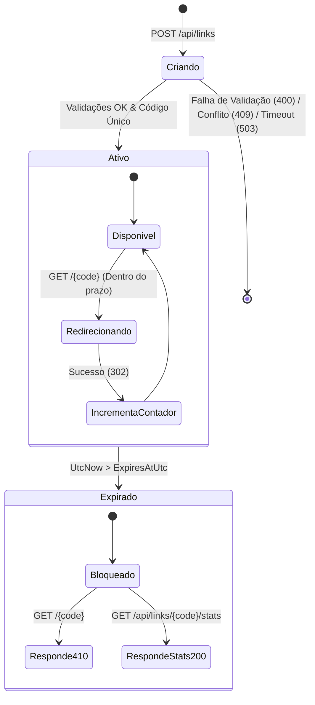

# Data Model: Encurtador de URLs

**Feature**: [Encurtador de URLs (URL Shortener)](spec.md)
**Status**: Completed

Este documento define o modelo de dados, propriedades, restrições relacionais, regras de validação e o ciclo de vida das entidades persistidas do encurtador de URLs.

---

## 1. Entidade de Domínio: `Link`

Representa o link encurtado, mapeando um código único para a URL de destino original, com controle de vigência e métricas de cliques.

### Esquema Físico (Tabela `Links`)

| Coluna | Tipo SQLite / .NET | Nulável | Descrição / Restrição |
|---|---|:---:|---|
| `Id` | `INTEGER` / `int` | Não | Chave primária incremental (`PK`). |
| `Code` | `TEXT` / `string` | Não | Código alfanumérico identificador (`UNIQUE INDEX`). Collation NOCASE ou normalizado. |
| `TargetUrl` | `TEXT` / `string` | Não | URL original de destino (máximo 2048 caracteres). |
| `CreatedAtUtc` | `TEXT` / `DateTime` | Não | Carimbo de data/hora de criação em UTC (ISO 8601). |
| `ExpiresAtUtc` | `TEXT` / `DateTime?` | Sim | Carimbo opcional de expiração em UTC. Se nulo, link é permanente. |
| `AccessCount` | `INTEGER` / `long` | Não | Contador cumulativo e atômico de acessos válidos (padrão: 0). |

### Índices e Restrições de Integridade

- **`PK_Links`**: Chave primária clustered em `Id`.
- **`IX_Links_Code`**: Índice exclusivo (`UNIQUE`) sobre a coluna `Code`, garantindo unicidade perpétua no banco de dados e prevenindo colisões concorrentes.

---

## 2. Regras de Validação e Integridade

### Regras do Campo `Code`
1. **Origem Automática**:
   - Comprimento fixo de 7 caracteres.
   - Alfabeto restrito a `[A-Z1-9]` (maiúsculas e dígitos de 1 a 9). O dígito `0` é expressamente proibido.
2. **Origem Personalizada**:
   - Comprimento entre 4 e 20 caracteres.
   - Restrito a `^[A-Z1-9]{4,20}$`. Letras minúsculas, espaços, o dígito `0` e pontuações são rejeitados com erro 400.
3. **Resolução no Acesso (Case-Insensitive)**:
   - Na criação, armazena em maiúsculas padronizadas.
   - No redirecionamento e consulta, a busca é insensível à caixa (`UPPER(code)` ou busca case-insensitive no repositório).

### Regras do Campo `TargetUrl`
1. **Formato**:
   - URI bem formada com esquema `http` ou `https`.
   - Comprimento máximo de 2048 caracteres.
2. **Anti-SSRF**:
   - Rejeição de endereços de loopback (`127.0.0.1`, `localhost`, `::1`).
   - Rejeição de endereços privados da RFC 1918 (`10.0.0.0/8`, `172.16.0.0/12`, `192.168.0.0/16`).
   - Rejeição de faixas de link-local (`169.254.0.0/16`) e multicast/broadcast.
3. **Verificação de Conectividade**:
   - Deve responder com código HTTP de sucesso (2xx ou 3xx) em requisição de verificação ativa com timeout de 3 segundos.

### Regras do Campo `ExpiresAtUtc`
1. Se fornecido com data e hora: deve ser estritamente posterior a `DateTime.UtcNow`.
2. Se fornecido apenas com data (`YYYY-MM-DD`): a expiração é normalizada para o fim daquele dia (`23:59:59 UTC`).
3. Se o valor for anterior a `DateTime.UtcNow`: criação rejeitada com erro 400.

### Regras do Campo `AccessCount`
1. Inicializado com valor zero (`0`).
2. Operação estritamente incremental e não-decrescente.
3. Atualização atômica direta no SQLite via `UPDATE Links SET AccessCount = AccessCount + 1 WHERE Id = @id`.

---

## 3. Máquina de Estados e Ciclo de Vida do Link

### Transições de Estado:
- **Ativo**:
  - `ExpiresAtUtc == null` OU `DateTime.UtcNow < ExpiresAtUtc`.
  - Acesso via `GET /{code}` redireciona com status 302 para `TargetUrl`.
  - Incrementa atomicamente `AccessCount` em 1.
  - Consulta de estatísticas retorna status 200 com métricas atuais.
- **Expirado**:
  - `ExpiresAtUtc != null` E `DateTime.UtcNow >= ExpiresAtUtc`.
  - Acesso via `GET /{code}` retorna status 410 Gone com ProblemDetails.
  - `AccessCount` é congelado (não sofre novo incremento).
  - Consulta de estatísticas permanece operacional, retornando status 200 com as métricas históricas preservadas.
